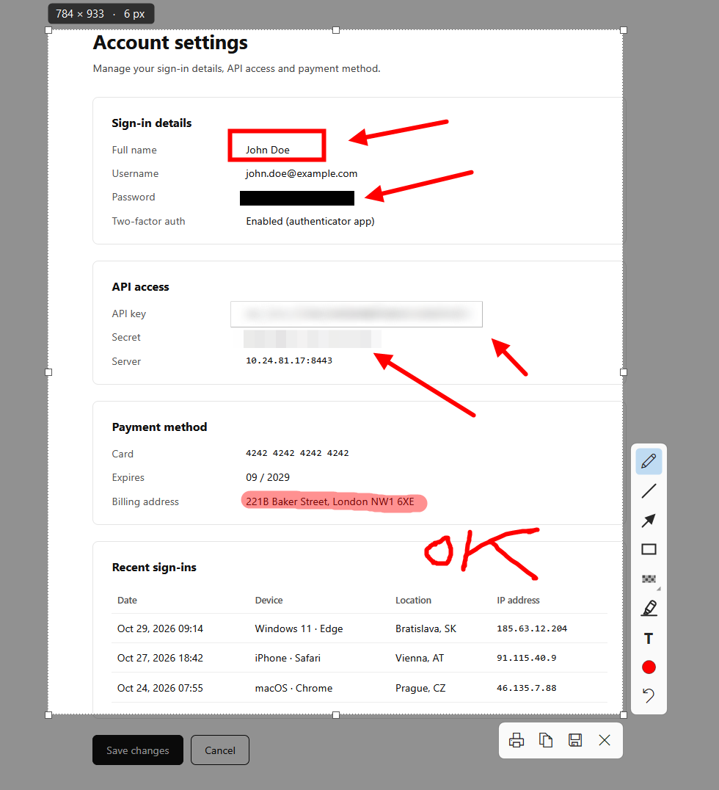

# ShotLite

[English](README.md) · **Slovenčina**

Ľahký nástroj na screenshoty a nahrávanie obrazovky pre Windows. Vznikol ako náhrada za už nepodporovaný **Lightshot 5.5.0.7**. Má rovnaký spôsob práce (PrtScr → výber oblasti → kreslenie → kopírovať/uložiť), ale **bez telemetrie a bez nahrávania na prntscr.com**. Navyše vie nahrávať obrazovku do MP4 alebo GIF.

  

## Stiahnutie

- **Inštalátor (odporúčaný):** [ShotLite-install.exe](https://github.com/otazniksk/ShotLite/releases/latest/download/ShotLite-install.exe). Inštaluje sa pre aktuálneho používateľa a nepotrebuje administrátorské práva.
- **Prenosná verzia:** [ShotLite-portable.zip](https://github.com/otazniksk/ShotLite/releases/latest/download/ShotLite-portable.zip). Rozbaľ a spusti `ShotLite.exe`.
- Všetky verzie a poznámky k nim: [Releases](https://github.com/otazniksk/ShotLite/releases).

Windows 10/11 x64. .NET je súčasťou balíka. Nahrávanie obrazovky vyžaduje Windows 10 verzie 2004 alebo novší.

Nainštalovaná aplikácia ponúkne novú verziu v menu v lište a nainštaluje ju jedným kliknutím, alebo automaticky, ak si to zapneš v nastaveniach. Každá aktualizácia sa pred spustením overí digitálnym podpisom. Prenosná verzia namiesto toho otvorí stránku na stiahnutie.

## Ovládanie

| Akcia | Ovládanie |
|---|---|
| Výber oblasti | `PrtScr`, alebo ľavý klik na ikonu v lište |
| Uložiť celú obrazovku (do priečinka) | `Shift+PrtScr` |
| Kopírovať celú obrazovku | `Ctrl+PrtScr` |
| Nahrať obrazovku do MP4 alebo GIF, zastaviť rovnako (Windows 10 2004+) | `Ctrl+Shift+PrtScr`, potom stlač Nahrať celý monitor alebo vyber oblasť a stlač `Enter`; alebo červené tlačidlo v overlayi (`Ctrl+R`). Podržaním tlačidla zvolíš formát a kurzor |
| Pomer strán výberu (screenshoty aj nahrávky) | `V` alebo tlačidlo pomeru; podržaním vyberieš. Pomery a predvolený sú v nastaveniach |
| Celý monitor pod kurzorom | `Ctrl+A` v overlayi |
| Posun / zmena veľkosti výberu | ťahanie vnútri výberu / za úchyty |
| Nástroje | `P` ceruzka, `L` čiara, `A` šípka, `R` obdĺžnik, `B` začierniť, `M` zvýrazňovač, `T` text |
| Štýl začiernenia (čierna / matné sklo / pixelizácia) | podržať alebo pravý klik na ikonu Začierniť; voľba sa pamätá |
| Hrúbka čiary / veľkosť textu | koliesko myši |
| Rovná čiara pod 45° / štvorec | držať `Shift` pri kreslení |
| Späť | `Ctrl+Z` |
| Kopírovať | `Ctrl+C`, `Enter` alebo klik mimo výberu |
| Nový výber | ťahanie mimo výberu (kým nie je nič nakreslené) |
| Uložiť | `Ctrl+S` |
| Tlačiť | `Ctrl+P` |
| Nahrať (ak je nastavené) | `Ctrl+U` |
| Zrušiť | `Esc` alebo pravý klik |

Text: klikni nástrojom Text do výberu, píš, potvrď `Enter` (`Shift+Enter` = nový riadok, `Esc` = zrušiť).

## Nahrávanie obrazovky

- Vybraná oblasť alebo jeden celý monitor, bez zvuku.
- MP4 (H.264, 30 fps) alebo GIF (15 fps, šírka do 800 px, dĺžka do 60 sekúnd).
- Formát a nahrávanie kurzora zvolíš podržaním červeného tlačidla; predvolený formát je aj v nastaveniach.
- Nahrávky sa ukladajú do `Videos\ShotLite` a po zastavení sa priečinok otvorí. Oboje zmeníš v nastaveniach, oddelene od screenshotov.
- Rámik a lišta s časom a zastavením sa do záznamu nedostanú.

## Pomery strán

Výber sa dá zamknúť na pomer strán, pre screenshoty aj nahrávky. Predvolené sú 9:16, 4:3 a 16:9. Zoznam aj predvolený pomer zmeníš v nastaveniach.

## Jazyky

Texty sú v `languages\<kód>.json` vedľa `ShotLite.exe`, kód je ISO názov jazyka a krajiny (napr. `sk-SK`, `en-US`, `de-DE`; spolu 15 jazykov). Aplikácia ponúkne v nastaveniach každý súbor, ktorý v priečinku nájde. Pri prvom spustení sa zvolí podľa jazyka Windows (najprv presná zhoda, potom rovnaký jazyk, inak angličtina). Angličtina je zabudovaná aj priamo v exe, takže chýbajúci kľúč alebo súbor nič nerozbije.

Nový jazyk: skopíruj `en-US.json` napr. ako `ro-RO.json`, prelož hodnoty a uprav `_language` (názov v zozname). Kľúče nemeň.

## Licencia

ShotLite je open source pod licenciou [MIT](LICENSE).

## Testeri

Ďakujem za testovanie ShotLite ❤️

[Arduinak](https://github.com/Arduinak), [Spacesov](https://github.com/Spacesov)
